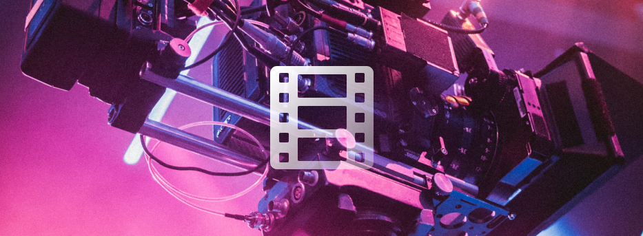

# Mpeg - MPEG-1 video and MP2 audio for Nim.

`nimby install mpeg`

[API reference](https://treeform.github.io/mpeg)

## About

Mpeg wraps [PL_MPEG](https://github.com/phoboslab/pl_mpeg) and compiles its
bundled C decoder directly into your application. The core library depends
only on Nim's standard library and the C toolchain used by Nim.

- MPEG-1 video and MPEG-PS container decoding.
- MP2 audio as interleaved stereo float32 samples.
- File and memory inputs with automatic cleanup and explicit `close`.
- Reusable RGBA frame buffers and signed 16-bit audio conversion.
- Direct C bindings for timed callbacks, seeking, looping, and custom input.

> **AI disclaimer: Parts of the Nim wrapper and test suite were AI generated.**

The decoder produces pixels and samples. Your application owns presentation,
the sound device, and playback timing. Optional manual players demonstrate
those parts without adding graphics or audio dependencies to the library.

## Video decoding

```nim
import mpeg

block:
  let decoder = openMpeg("clip.mpg")
  defer: decoder.close()
  decoder.audioEnabled = false

  var frame: VideoFrame
  while decoder.decodeVideo(frame):
    echo frame.time, " ", frame.width, "x", frame.height
    # Upload frame.rgba to a texture and present it at frame.time.
```

`VideoFrame.rgba` contains packed RGBA8 pixels with opaque alpha. Decoding
reuses the destination sequence when its size is unchanged. The output belongs
to Nim and remains valid after closing the decoder.

Use `newMpeg(data)` for an in-memory file. The decoder retains the data.
`openMpeg` reads incrementally and supports Unicode paths through Nim's file API.
Invalid initial headers and file errors raise `MpegError`.

## Audio decoding

```nim
import mpeg

block:
  let decoder = openMpeg("clip.mpg")
  defer: decoder.close()
  decoder.videoEnabled = false

  var frame: AudioFrame
  while decoder.decodeAudio(frame):
    let pcm = frame.pcm16()
    echo frame.sampleRate, " Hz, ", pcm.len div 2, " stereo sample frames"
    # Queue pcm to a stereo sound device running at frame.sampleRate.
```

Each MP2 packet produces 1152 sample frames. `samples` contains 2304 float32
values, alternating left and right. Mono input is duplicated into both channels.
`pcm16` clips to signed 16-bit PCM in native byte order.

Disable streams you do not consume. Otherwise the demuxer buffers them while
decoding the other stream. For audio and video together, consume both regularly
and use the sound device's playback position as the presentation clock.

`decodeVideo` and `decodeAudio` return false when the stream ends, is disabled,
or cannot be decoded. Upstream does not distinguish corrupt data from EOF.
Use this library for known MPEG-1/MP2 inputs, not as a general media validator.

## Direct bindings

All `plm_*` functions remain available through `import mpeg`. `decoder.raw`
borrows the handle for an owned Nim decoder. Do not destroy that borrowed handle.
Raw constructors require a matching `plm_destroy` call. Never pass
`free_when_done = 1` for memory owned by Nim.

Native callbacks must use `{.cdecl, raises: [].}`. Raw frame and audio pointers
are borrowed and must be consumed or copied before decoding the next frame of
that stream. RGB conversion functions take a destination stride in bytes.
The RGBA/BGRA variants leave the alpha byte untouched.

Version 0.2 updates the bindings to the current upstream API. `plm_decode`
returns no value. Use callbacks or `plm_has_ended` to track progress. The old
three-argument `plm_set_audio_enabled` and two-argument `plm_frame_to_rgb`
calls remain available as compatibility overloads.

The bundled revision and local EOF fix are recorded in
[UPSTREAM.md](src/mpeg/UPSTREAM.md). Decoder-only source remains C.

## Encoding

Use MPEG-1 video, optional MP2 audio, and an MPEG Program Stream container.
The `.mpg` extension alone does not guarantee those codecs. MPEG-2, MP4/H.264,
AAC, and MP3 audio are not supported by this decoder.

```sh
ffmpeg -i input.mp4 -r 30 -c:v mpeg1video -pix_fmt yuv420p -q:v 3 -bf 0 -c:a mp2 -ar 48000 -ac 2 -b:a 192k -f mpeg output.mpg
```

FFmpeg is an encoding tool, not a playback dependency. B-frames are supported
and tested, although `-bf 0` makes a simple production pipeline easier to seek
and stream. Use `-an` instead of the audio options for silent videos.

PL_MPEG estimates duration from packet timestamps and uses frame/sample clocks
for ordinary playback. Arbitrary timestamp discontinuities or initial audio
offsets may require application-specific synchronization.

## Development

From a workspace directory containing the checked-out repository:

```sh
nimby install mpeg/mpeg.nimble
cd mpeg
nim r tests/tests.nim
nim r -d:release tests/tests.nim
nim r examples/decode.nim
```

Tests run offline without a display, sound device, or FFmpeg. Synthetic fixtures
cover video and audio decoding, independent FFmpeg reference samples, mono and
stereo output, B-frame EOF handling, seeking, looping, callbacks, custom input,
Unicode paths, and invalid inputs. CI runs on Linux, macOS, and Windows.

Regenerate the synthetic fixtures with `nim r tools/gen_fixtures.nim` when
FFmpeg is installed. The [fixture notes](tests/data/README.md) describe them.

For optional decoding benchmarks, install `benchy` with Nimby and run
`nim r -d:release tests/bench_mpeg.nim`, optionally followed by a file path.

## Manual playback

The optional audio test uses OpenAL. The video player also uses Boxy and Windy.
Install these from your workspace directory:

```sh
nimby install openal boxy windy
```

Then run from the repository:

```sh
nim r tests/manual_audio.nim
nim r -d:release tests/manual_player.nim
nim r -d:release tests/manual_player.nim path/to/clip.mpg
```

The default clip plays distinct tones in the left and right channels. The audio
test verifies that every queued sample reaches the sound-device playback cursor
without buffer underruns. The player uses a bounded audio queue and follows
that cursor when presenting video. Escape closes the window. Add `--hold` after
the file path to keep the final frame visible.

On Windows, put the 64-bit `soft_oal.dll` from the OpenAL dependency's
`deps/win64` directory on PATH. On Linux, install the system OpenAL library.
macOS uses its OpenAL framework. These are requirements of the optional players.

Build the API reference with:

```sh
nim doc --index:on --project --out:.gh-pages src/mpeg.nim
```
